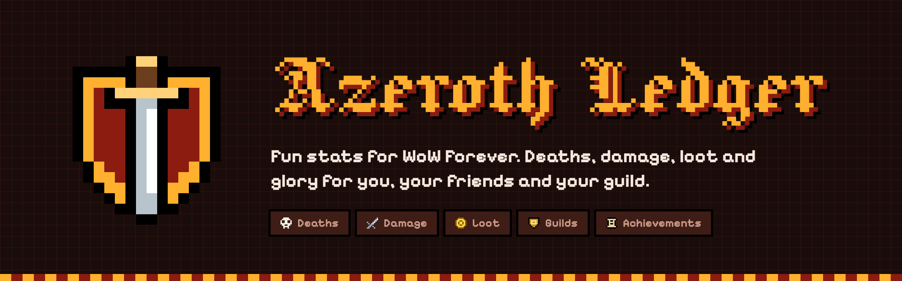
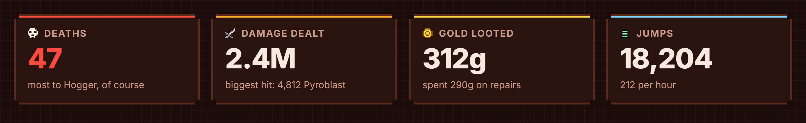
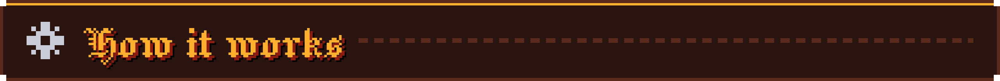
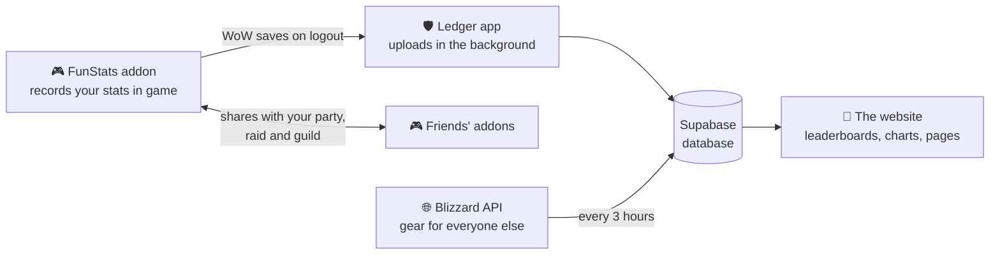
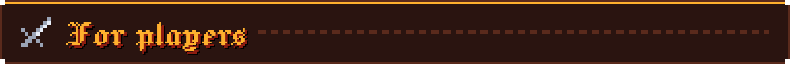
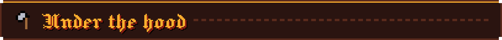

  

  <b>A WoW addon, a tiny Windows app and a website that turn your adventures into leaderboards, charts and bragging rights.</b> 
  Built for <b>WoW Forever</b> (launching Nov 4, 2026). Works on the Anniversary and Classic Era realms today.

  <a href="#for-players">Get started</a> ·
  <a href="#how-it-works">How it works</a> ·
  <a href="docs/setup.md">Setup guide</a> ·
  <a href="TESTING.md">Testing checklist</a>

 

The **FunStats** addon quietly records everything worth laughing about, per character:

| | |
|---|---|
| ⚔️ **Combat** | damage, healing, crits, overkill, killing blows, biggest hits, damage by ability |
| 🐉 **Dungeons & raids** | boss kills and wipes, fastest kills, a damage and healing meter for every boss fight, dungeon run times and who you ran with |
| 💀 **Deaths** | who or what killed you, where, at what level, falling and drowning included, plus your nemeses |
| 💰 **Loot & gold** | rare drops, gold looted and spent, repairs, your richest moment |
| 🗺️ **The world** | zones, distance run, jumps (yes, every one), time played, hearthstones |
| 🛡️ **Your character** | gear with Wowhead icons and tooltips, talents, professions, level-ups |
| 🏆 **Glory** | achievements like *Can't stop jumping* and *Spends ages dead*, personal bests, a Hall of Fame |

Everything is shown **per realm**, with **guild pages**, **search**, **character comparisons**, **weekly and all-time** views, three themes (**Horde**, **Alliance**, **Felfire**) and **English or Swedish**.

 

1. **The addon records** your stats per character, and the **guild roster**, so every guild mate appears on the site even without the addon.
2. **Addons share with each other.** While FunStats players group up or share a guild, their addons swap stats automatically.
3. **The Ledger app uploads** your stats a few seconds after every logout. WoW doesn't let addons reach the internet, so a small app outside the game does it.
4. **The Blizzard API** fills in level, guild and gear for guild members who don't run the addon.
5. **Everything stays up to date.** The app checks the website for a new version every 6 hours and updates itself and the addon. Nobody downloads anything twice.
6. **Your characters are yours.** Each install has a private upload code. The first upload claims a character, and nobody else can overwrite it.

 

### Windows: install once, then just play

1. Open **[azeroth-ledger.pages.dev](https://azeroth-ledger.pages.dev)**, go to **Add stats** and click **Download for Windows**.
2. Run `AzerothLedger.exe`. If Windows says it protected your PC, click **More info → Run anyway**. No admin rights needed.
3. A small shield appears in the tray. The app has now:
   - installed itself in `%LOCALAPPDATA%\AzerothLedger` and set itself to start with Windows,
   - installed the **FunStats** addon in every WoW folder it found (Anniversary, Classic Era and later WoW Forever).
4. Start WoW and play. A few seconds after you log out (or `/reload`), your stats are on the site.

You can delete the downloaded file afterwards; the installed copy is the one that runs.

### Updates are automatic

You never need to download the app again. When it starts, and every 6 hours after that, it checks the website for a newer version. If there is one, it downloads it, checks that the file matches the published SHA-256 hash, and replaces itself in the background. Each new app carries the newest addon, which it copies into your AddOns folders right away. **Restart WoW** to load a new addon version.

The tray menu's **Show log** lists every update ("Updated to version …"). The website's *Add stats* page shows the current version next to the download button.

> Apps older than 1.1 can't update themselves: download the app once more and it takes over from there.

To stop it, right-click the shield and untick **Start with Windows**, or choose **Quit**.

### Mac, or without the app

Download `FunStats.zip`, put the `FunStats` folder in `World of Warcraft\_anniversary_\Interface\AddOns` (or your WoW Forever folder), play, then drop `WTF\Account\<ACCOUNT>\SavedVariables\FunStats.lua` on the *Add stats* page. Without the app nothing updates by itself: download the zip again now and then, and upload after you play.

Nothing needs typing in game: the addon records, shares with your group and guild, and tracks guild mates and WoW friends without it on its own. `/funstats` shows today's numbers and the optional commands.

 

The website is a static page, live at **[azeroth-ledger.pages.dev](https://azeroth-ledger.pages.dev)** on Cloudflare Pages, backed by a free Supabase project. Every push to `main` publishes it.

**Shipping an update to every player:** raise `AssemblyVersion` in [`app/LedgerApp.cs`](app/LedgerApp.cs), run `app\build.cmd` (it writes `AzerothLedger.exe`, `FunStats.zip` and `app-version.txt` to `site/`), and push. Installed apps pick it up within 6 hours, or at their next start. Without a higher version number, nobody gets the new build.

The **[setup guide](docs/setup.md)** walks through the database, hosting, the Blizzard API and building the app. The **[testing checklist](TESTING.md)** covers a full test run on an Anniversary realm.

 

| Folder | What's inside |
|---|---|
| [`FunStats/`](FunStats) | The WoW addon (Lua): `FunStats.lua` records, `Sync.lua` shares stats between players |
| [`app/`](app) | The Windows app (C#, built with the compiler that ships with Windows: `app\build.cmd`) |
| [`site/`](site) | The website: `index.html`, `app.js`, `styles.css` and `config.js` (vanilla JS, Chart.js, Wowhead tooltips), plus the downloads |
| [`supabase/`](supabase) | Database setup (SQL) and the `armory` Edge Function for the Blizzard API |
| [`sync/`](sync) | A Python uploader for Mac and Linux |
| [`tests/`](tests) | Checks for the upload rules and the uploaders |
| [`docs/`](docs) | The setup guide, and the README artwork (`docs/src/make_images.py` regenerates it) |

The pixel logo lives in [`app/logo.py`](app/logo.py) as a 16×16 grid and is shared by the app icon, the website and this README.

 

  A fan project for friends and guilds. Not affiliated with or endorsed by Blizzard Entertainment. World of Warcraft and Blizzard Entertainment are trademarks of Blizzard Entertainment, Inc.

